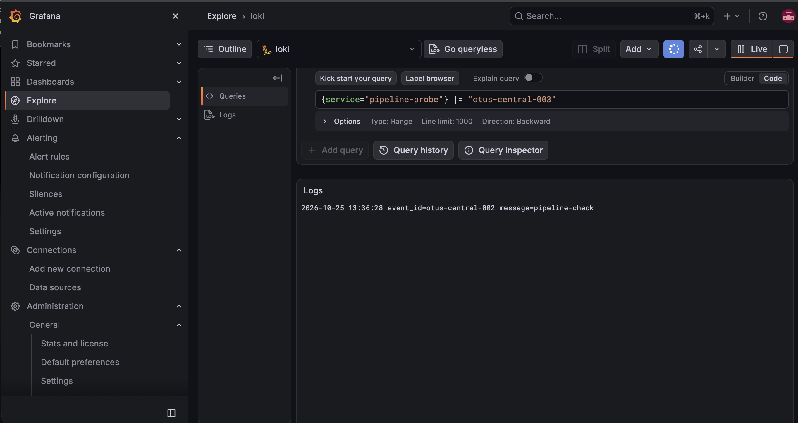

# Домашнее задание 11

Конфигурации Grafana Loki.

## Что сделал

Для хранения логов настроил Grafana Loki 3.6.19, для сбора — Grafana Alloy 1.21.0. Loki подключил к Grafana как источник данных. Используется файловое хранилище, срок хранения логов — 7 дней.

Alloy отправляет структурированные события состояния VPN с двух серверов через SSH-туннели. Проверил поступление трёх потоков: USA/AmneziaWG, NL/AmneziaWG и NL/WireGuard. Это события собственного сборщика состояния, а не access logs VPN.

## Конфигурации

- [Loki](loki.yaml)
- [Alloy на USA](alloy-us.alloy)
- [Alloy на NL](alloy-nl.alloy)

## Проверка

В Grafana Explore выбрал источник Loki и проверил получение контрольного события. На скриншоте показана эта проверка; VPN-потоки проверял отдельно.



Для просмотра VPN-событий использовал запрос:

```logql
{environment="project", service="vpn-state"} | json
```
