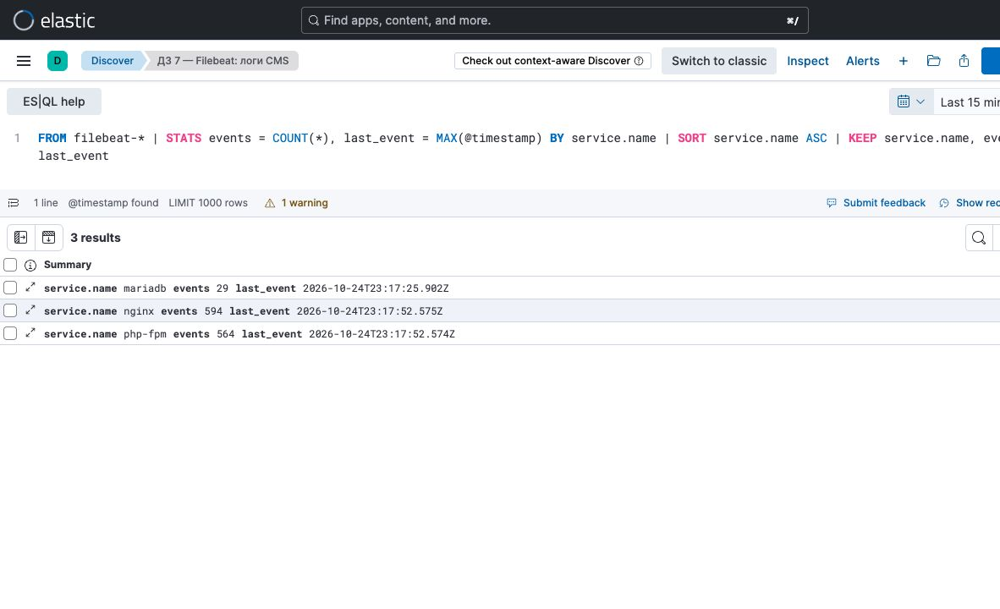
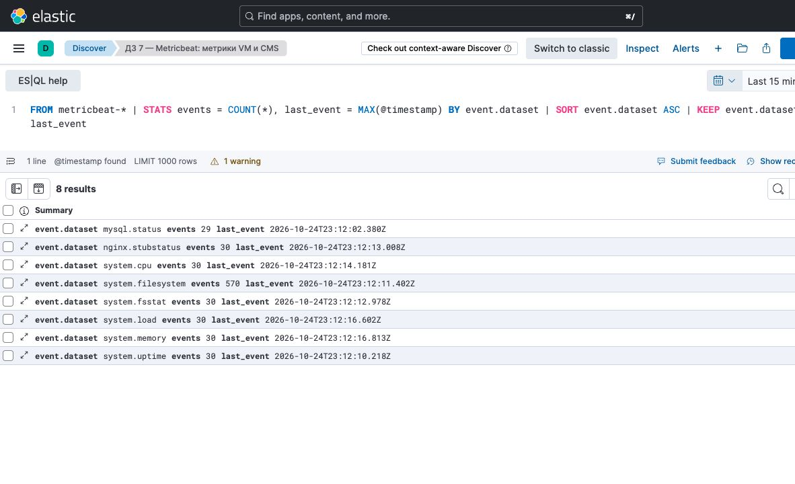
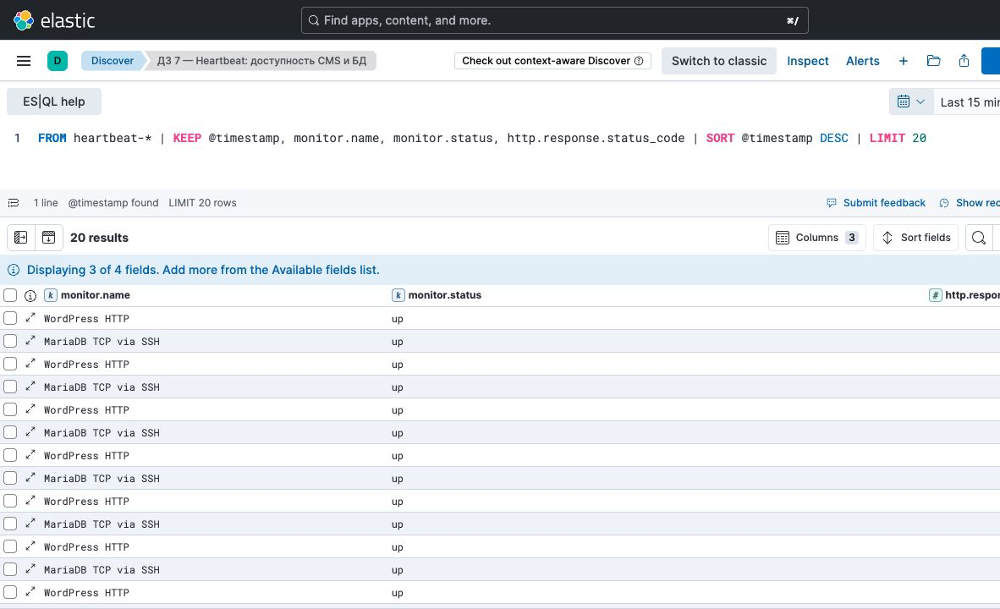

# Домашнее задание 7

Настройка отправки данных с помощью Beats.

## Что сделал

На первой VM использовал WordPress с nginx, PHP-FPM и MariaDB. Настроил Filebeat для сбора логов этих компонентов и Metricbeat для метрик VM, nginx и базы данных.

На второй VM установил Elasticsearch, Kibana и Heartbeat. Heartbeat проверяет WordPress по HTTP и MariaDB по TCP через SSH-туннель. Версия Elastic Stack и Beats — 8.19.22.

Данные всех трёх Beats поступают в Elasticsearch и отображаются в Kibana Discover. Обязательную часть выполнил, дополнительные задания с ILM и dissect не делал.

## Конфигурации

- [Filebeat](filebeat.yml)
- [Metricbeat](metricbeat.yml)
- [Heartbeat](heartbeat.yml)

## Скриншоты

### Логи nginx, PHP-FPM и MariaDB

### Метрики VM, nginx и MariaDB

### Проверки доступности WordPress и MariaDB

